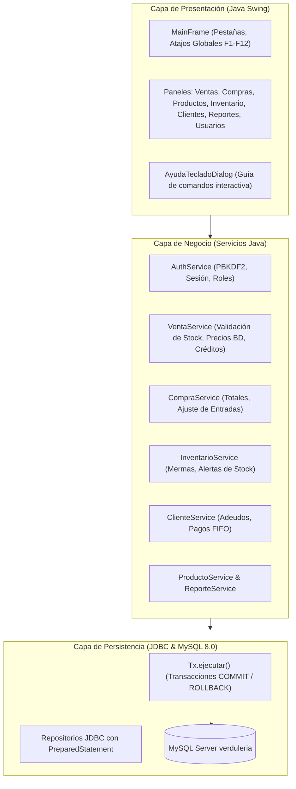
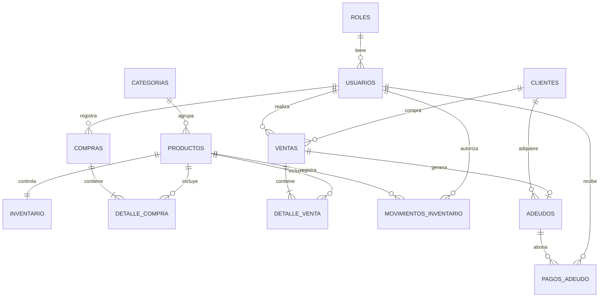

# UNIVERSIDAD VERACRUZANA
## FACULTAD DE CONTADURÍA Y ADMINISTRACIÓN
### Licenciatura en Sistemas Computacionales Administrativos
**Experiencia Educativa:** Programación e implementación de sistemas  
**Docente:** Eloisa Ruiz González  
**Actividad:** Tecnologías emergentes en TI  

**Alumnos:**
- Martínez López Cristian
- Quiroz Morales Sergio Ivan
- Solano Fernandez Kevin Omar
- Sustersick Reducindo Angel Gustavo

---

# Sistema de Gestión para Verdulería Jiménez
## Documento de Especificación, Arquitectura y Manual del Sistema

---

## Índice
1. [Propósito y Alcance](#1-propósito-y-alcance)
2. [Antecedentes de la Empresa](#2-antecedentes-de-la-empresa)
3. [Estudio de Factibilidad](#3-estudio-de-factibilidad)
4. [Análisis de Requerimientos](#4-análisis-de-requerimientos)
5. [Requerimientos Funcionales (RF)](#5-requerimientos-funcionales-rf)
6. [Requerimientos No Funcionales (RNF)](#6-requerimientos-no-funcionales-rnf)
7. [Casos de Uso del Sistema](#7-casos-de-uso-del-sistema)
8. [Arquitectura del Sistema](#8-arquitectura-del-sistema)
9. [Modelo Relacional y Diccionario de Datos](#9-modelo-relacional-y-diccionario-de-datos)
10. [Catálogo y Manual de Comandos de Navegación por Teclado](#10-catálogo-y-manual-de-comandos-de-navegación-por-teclado)
11. [Registro de Ajustes y Mejoras Técnicas Implementadas](#11-registro-de-ajustes-y-mejoras-técnicas-implementadas)

---

## 1. Propósito y Alcance

### 1.1 Propósito
El presente documento tiene como propósito establecer y documentar los requerimientos funcionales, requerimientos no funcionales, estructura de base de datos, arquitectura de software y manual operativo por teclado para el **Sistema de Gestión de Verdulería Jiménez**.

El sistema tiene como finalidad centralizar y organizar las operaciones cotidianas de la verdulería: catálogo de productos, control riguroso de inventario en tiempo real, registro de compras al mayoreo en la Central de Abastos, punto de venta de mostrador y a crédito, gestión de clientes y adeudos, reportes ejecutivos con exportación de datos y una interfaz de usuario en Java Swing diseñada para una operación fluida mediante atajos de teclado.

### 1.2 Alcance
El proyecto abarca el análisis, diseño, codificación, pruebas y despliegue del sistema para una arquitectura monoequipo de tres capas lógicas.
El sistema integra los siguientes módulos:
- **Autenticación y usuarios:** control de acceso basado en roles (*Administrador* y *Cajero*) con almacenamiento seguro de contraseñas mediante hashing PBKDF2 con salt.
- **Gestión de productos:** catálogo de productos con unidades de medida, categorías, precios de venta y activación/desactivación lógica.
- **Control de inventario:** existencias en tiempo real, detección de stock mínimo, registro de mermas con justificación y bitácora de movimientos.
- **Gestión de compras:** registro de adquisiciones directas en la Central de Abastos (sin requerir catálogo de proveedores), aumentando automáticamente las existencias.
- **Gestión de ventas (Punto de Venta):** venta de mostrador y a crédito, validación atómica contra existencias para evitar sobreventas, y cálculo automático de importes.
- **Gestión de clientes y adeudos:** control de clientes, registro de ventas fiadas (adeudos) y abonos con amortización FIFO (se liquidan primero los adeudos más antiguos).
- **Reportes:** consulta de ventas, inventario actual, productos bajo stock, compras, movimientos y saldos de adeudos, con exportación a formato CSV compatible con hojas de cálculo.
- **Navegación accesible por teclado:** conjunto completo de atajos (`F1`-`F12`, `Ctrl+1..7`, `Enter`, `Supr`) para operar el sistema sin depender del ratón.

---

## 2. Antecedentes de la Empresa

### 2.1 Antecedentes
La Verdulería Jiménez es un establecimiento local dedicado a la comercialización de frutas, verduras y legumbres frescas. Surgió como iniciativa de emprendimiento para abastecer a las familias de la comunidad con alimentos básicos de calidad a precios justos.

### 2.2 Misión
Ofrecer frutas y verduras frescas y de buena calidad a precios accesibles, brindando una atención amable y respetuosa que permita satisfacer las necesidades de los clientes de Verdulería Jiménez y contribuir a una alimentación saludable.

### 2.3 Visión
Ser una verdulería reconocida en la comunidad por la frescura de sus productos, sus precios accesibles y la calidad de su servicio, logrando un crecimiento constante y la preferencia de los clientes.

### 2.4 Valores
- **Responsabilidad:** cumplimiento puntual en las operaciones cotidianas.
- **Honestidad:** precios transparentes y báscula exacta.
- **Respeto:** trato digno y cordial a clientes y colaboradores.
- **Calidad:** selección diaria de mercancía fresca.
- **Compromiso:** dedicación constante para satisfacer las necesidades del consumidor.

### 2.5 Objetivos y Metas
- **Objetivo General:** Comercializar frutas y verduras frescas y de calidad, optimizando las operaciones de compra, venta e inventario a través de una solución de software confiable.
- **Metas a corto plazo:** Sistematizar el registro de compras y ventas, evitar pérdidas por descontrol de existencias y agilizar el cobro en mostrador.
- **Metas a largo plazo:** Consolidar la preferencia de la comunidad, analizar tendencias de demanda mediante reportes y expandir la variedad de productos ofrecidos.

---

## 3. Estudio de Factibilidad

- **Factibilidad Técnica:** El desarrollo se implementa en Java 17+ (Java Swing) con base de datos relacional MySQL Server 8.0 local y conectividad JDBC. El equipo de cómputo del establecimiento cuenta con la capacidad de procesamiento y memoria necesaria para ejecutar la solución monoequipo.
- **Factibilidad Operativa:** El software se adapta al flujo natural del negocio: compras directas en la Central de Abastos sin proveedores intermedios, cobro rápido de mostrador con teclado y control de crédito a clientes conocidos. La curva de aprendizaje es mínima gracias a los atajos de teclado visuales y la ayuda interactiva (`F1`).
- **Factibilidad Económica y Financiera:** Se emplean tecnologías de código abierto y licencias gratuitas (Java OpenJDK, MySQL Community Server, Maven), eliminando costos de licenciamiento de software.
- **Factibilidad Ética:** La información financiera, de compras y de clientes es privada y reside únicamente en la máquina local del negocio, protegida por autenticación y perfiles de acceso.

---

## 4. Análisis de Requerimientos

### Glosario de Términos
| Término | Definición |
| :--- | :--- |
| **Existencia** | Cantidad física actual registrada de un producto disponible para su venta. |
| **Stock mínimo** | Umbral de inventario por debajo del cual se recomienda resurtir el producto. |
| **Merma** | Pérdida de producto por daño, maduración excesiva o desperdicio justificado. |
| **Venta a crédito (Fiado)** | Venta entregada al cliente cuyo importe total o parcial queda pendiente de pago mediante un adeudo. |
| **Amortización FIFO** | Regla por la cual un abono de dinero se aplica saldando primero las deudas más antiguas del cliente. |
| **Transacción Atómica** | Bloque de operaciones de base de datos que se aplican todas con éxito (`COMMIT`) o ninguna (`ROLLBACK`). |

---

## 5. Requerimientos Funcionales (RF)

### Módulo: Autenticación y Usuarios
- **RF-AUT-01:** Inicio de sesión mediante credenciales válidas (usuario y contraseña).
- **RF-AUT-02:** Identificación clara del usuario autenticado y su rol en la interfaz.
- **RF-AUT-03:** Restricción estricta de funciones y pestañas según el rol (*Administrador* o *Cajero*), validada en la interfaz y en los servicios.
- **RF-AUT-04:** Registro y administración de usuarios por parte del Administrador.
- **RF-AUT-05:** Cierre seguro de sesión regresando a la pantalla de acceso.

### Módulo: Gestión de Productos
- **RF-PRO-01:** Registro de nuevos productos con nombre, categoría, unidad (`kg`, `pieza`, `manojo`, `otro`), precio de venta y stock mínimo.
- **RF-PRO-02:** Consulta del catálogo de productos con búsqueda en tiempo real.
- **RF-PRO-03:** Modificación de datos de productos registrados.
- **RF-PRO-04:** Actualización de precios de venta para operaciones futuras.
- **RF-PRO-05:** Desactivación lógica de productos descontinuados (impide agregarlos a nuevas ventas).
- **RF-PRO-06:** Identificador único (clave primaria) para cada producto sin nombres duplicados.

### Módulo: Control de Inventario
- **RF-INV-01:** Consulta de existencias actuales de cada producto.
- **RF-INV-02:** Incremento automático de existencias tras confirmar una compra.
- **RF-INV-03:** Descuento automático de existencias tras confirmar una venta.
- **RF-INV-04:** Consulta de la bitácora de movimientos de entrada y salida con fecha y usuario.
- **RF-INV-05:** **Bloqueo de sobreventa:** el sistema impide ventas que superen la existencia disponible en inventario.
- **RF-INV-06:** Registro de mermas descontando existencias y registrando el motivo.
- **RF-INV-07:** Resaltado visual de productos que alcancen o bajen de su stock mínimo.

### Módulo: Gestión de Compras
- **RF-COM-01:** Registro de compras de mercancía realizadas en la Central de Abastos.
- **RF-COM-02:** Selección de productos y cantidades adquiridas.
- **RF-COM-03:** Registro de precios de compra unitarios al mayoreo.
- **RF-COM-04:** Cálculo automático del subtotal por renglón y total de la compra.
- **RF-COM-05:** Actualización atómica de existencias y generación de movimiento `entrada_compra`.
- **RF-COM-06:** Consulta del historial de compras y visualización del detalle de conceptos.
- **RF-COM-07:** Operación sin catálogo de proveedores obligatorio.

### Módulo: Gestión de Ventas
- **RF-VEN-01:** Registro de ventas de mostrador y ventas a clientes específicos.
- **RF-VEN-02:** Selección de múltiples productos con cantidades decimales o enteras.
- **RF-VEN-03:** Cálculo automático de importe por renglón basado en el precio oficial de la base de datos.
- **RF-VEN-04:** Cálculo automático del total a cobrar.
- **RF-VEN-05:** Descuento atómico de existencias y generación de movimiento `salida_venta`.
- **RF-VEN-06:** Consulta de historial de ventas y reimpresión/visualización de tickets y detalles.

### Módulo: Clientes y Adeudos
- **RF-CLI-01:** Registro de clientes con nombre y teléfono de contacto.
- **RF-CLI-02:** Consulta y modificación de información de clientes.
- **RF-CLI-03:** Asociación de ventas con clientes registrados.
- **RF-CLI-04:** Control de adeudos (ventas fiadas): registro de adeudos vinculados a ventas o manuales, registro de abonos y liquidación en orden FIFO sin permitir sobrepagos.

### Módulo: Reportes
- **RF-REP-01:** Reporte de ventas en periodos seleccionados con totales acumulados.
- **RF-REP-02:** Reporte de existencias de inventario.
- **RF-REP-03:** Reporte de compras históricas y totales de inversión.
- **RF-REP-04:** Reporte de productos con baja existencia (bajo stock mínimo).
- **RF-REP-05:** Reporte de bitácora de movimientos de inventario.
- **RF-REP-06:** Exportación de reportes a archivos en formato CSV con soporte UTF-8.

### Módulo: Navegación y Accesibilidad por Teclado
- **RF-NAV-01:** Navegación por atajos de teclado (`Ctrl+1..7`, `Alt+[Letra]`, `Ctrl+Tab`) para cambiar de módulo instantáneamente.
- **RF-NAV-02:** Operación de punto de venta rápida mediante teclas de función (`F2` a `F9`, `Enter`, `Supr`).
- **RF-NAV-03:** Acceso instantáneo a la ventana de ayuda de atajos mediante la tecla **`F1`**.

---

## 6. Requerimientos No Funcionales (RNF)

- **RNF-01 (Usabilidad):** Interfaz gráfica Swing intuitiva, responsiva y con retroalimentación inmediata.
- **RNF-02 (Seguridad):** Contraseñas cifradas con algoritmo robusto **PBKDF2-HMAC-SHA256** (120,000 iteraciones y salt aleatorio de 16 bytes).
- **RNF-03 (Persistencia organizada):** Esquema relacional con integridad referencial (claves foráneas, restricciones de unicidad y cheques).
- **RNF-04 (Validación de datos):** Validación estricta en servidor y cliente para importes, cantidades, formatos de fecha y caracteres permitidos.
- **RNF-05 (Rendimiento):** Consultas indexadas y tiempos de respuesta inferiores a 100 ms en operaciones locales.
- **RNF-06 (Consistencia y Atomicidad):** Uso estricto de transacciones JDBC (`setAutoCommit(false)`, `commit()` y `rollback()`) para garantizar que compras, ventas y pagos se completen al 100% o no afecten la base de datos.
- **RNF-07 (Respaldo y Recuperación):** Procedimiento documentado con `mysqldump` para copias de seguridad de la base de datos.
- **RNF-08 (Mantenibilidad):** Separación limpia en arquitectura de 3 capas (Presentación, Negocio y Persistencia).
- **RNF-09 (Entorno de Ejecución):** Compatibilidad con Windows 10/11 y Linux con JDK 17 o superior.
- **RNF-10 (Operación sin ratón):** Cobertura completa de operaciones esenciales por teclado para agilizar la labor de cobro.

---

## 7. Casos de Uso del Sistema

### CU-AUT-01: Iniciar Sesión
- **Actor:** Administrador o Cajero.
- **Flujo:** El usuario ingresa usuario, presiona `Enter` para saltar a contraseña, ingresa contraseña y presiona `Enter` para ingresar. El sistema valida el hash y abre la ventana principal con los permisos del rol.

### CU-VEN-01: Registrar Venta en Punto de Venta
- **Actor:** Cajero o Administrador.
- **Flujo:**
  1. Presionar `F2` para seleccionar el producto del catálogo.
  2. Presionar `F3` para indicar la cantidad deseada.
  3. Presionar `Enter` para agregar el producto a la lista de venta.
  4. Si es una venta a crédito, presionar `F4` para marcar la casilla y `F6` para elegir al cliente.
  5. Presionar `F9` o `Ctrl + Enter` para confirmar la venta.
  6. El sistema descuenta las existencias, registra los movimientos en la bitácora y muestra el folio generado.

### CU-COM-01: Registrar Compra de Mercancía
- **Actor:** Cajero o Administrador.
- **Flujo:**
  1. Presionar `F2` para seleccionar el producto adquirido en la Central de Abastos.
  2. Presionar `F3` para ingresar la cantidad comprada.
  3. Presionar `F4` para ingresar el precio de compra unitario.
  4. Presionar `Enter` para añadir a la lista.
  5. Presionar `F9` o `Ctrl + Enter` para confirmar la compra.
  6. El sistema aumenta las existencias y calcula el costo total.

### CU-INV-03: Registrar Merma de Producto
- **Actor:** Administrador.
- **Flujo:**
  1. En la pestaña Inventario (`Alt+I`), seleccionar el producto de la tabla.
  2. Presionar `F2` o `Alt+M`.
  3. Ingresar la cantidad deteriorada y el motivo de la pérdida.
  4. Confirmar para descontar las existencias y registrar el movimiento `merma`.

### CU-CLI-04: Registrar Pago de Adeudo
- **Actor:** Cajero o Administrador.
- **Flujo:**
  1. En la pestaña Clientes (`Alt+L`), seleccionar al cliente.
  2. Presionar `F6` para abrir el formulario de pago.
  3. Ingresar el monto recibido. El sistema valida que no exceda el saldo pendiente.
  4. El abono se aplica saldando primero los adeudos más antiguos del cliente (orden FIFO).

---

## 8. Arquitectura del Sistema

El sistema implementa una **arquitectura monoequipo de 3 capas lógicas**:

---

## 9. Modelo Relacional y Diccionario de Datos

### Diagrama de Relaciones de la Base de Datos

### Diccionario de Tablas Principales

| Tabla | Campo | Tipo | Clave | Nulo | Regla / Observación |
| :--- | :--- | :--- | :---: | :---: | :--- |
| **roles** | `id_rol` | INT | PK | NO | AUTO_INCREMENT (`Administrador`, `Cajero`) |
| | `nombre` | VARCHAR(40) | | NO | Nombre único del rol |
| **usuarios** | `id_usuario` | INT | PK | NO | AUTO_INCREMENT |
| | `id_rol` | INT | FK | NO | Referencia a `roles(id_rol)` |
| | `nombre` | VARCHAR(100) | | NO | Nombre completo |
| | `usuario` | VARCHAR(60) | | NO | Identificador único de acceso |
| | `password_hash` | VARCHAR(255) | | NO | Hash PBKDF2-HMAC-SHA256 con salt |
| | `activo` | BOOLEAN | | NO | Estado de la cuenta (DEFAULT TRUE) |
| **categorias** | `id_categoria` | INT | PK | NO | AUTO_INCREMENT (`Frutas`, `Verduras`, etc.) |
| | `nombre` | VARCHAR(80) | | NO | Nombre único de categoría |
| **productos** | `id_producto` | INT | PK | NO | AUTO_INCREMENT |
| | `id_categoria` | INT | FK | SÍ | Referencia a `categorias(id_categoria)` |
| | `nombre` | VARCHAR(120) | | NO | Nombre del artículo (único, insensible a mayúsculas) |
| | `unidad_medida` | ENUM | | NO | `'kg'`, `'pieza'`, `'manojo'`, `'otro'` |
| | `precio_venta` | DECIMAL(12,2) | | NO | CHECK (`precio_venta >= 0`) |
| | `activo` | BOOLEAN | | NO | Control de descontinuación lógica |
| **inventario** | `id_producto` | INT | PK, FK| NO | Referencia 1:1 con `productos(id_producto)` |
| | `existencia` | DECIMAL(12,3) | | NO | Cantidad disponible (CHECK `>= 0`) |
| | `stock_minimo` | DECIMAL(12,3) | | NO | Límite de alerta preventiva (CHECK `>= 0`) |
| **clientes** | `id_cliente` | INT | PK | NO | AUTO_INCREMENT |
| | `nombre` | VARCHAR(120) | | NO | Nombre del cliente |
| | `telefono` | VARCHAR(25) | | SÍ | Teléfono de contacto |
| | `activo` | BOOLEAN | | NO | Estado activo |
| **compras** | `id_compra` | INT | PK | NO | AUTO_INCREMENT |
| | `id_usuario` | INT | FK | NO | Usuario que registró la compra |
| | `fecha` | DATETIME | | NO | Fecha y hora de compra |
| | `total` | DECIMAL(12,2) | | NO | Suma de subtotales |
| | `estado` | ENUM | | NO | `'borrador'`, `'confirmada'`, `'cancelada'` |
| **detalle_compra** | `id_detalle_compra` | INT | PK | NO | AUTO_INCREMENT |
| | `id_compra` | INT | FK | NO | Referencia a `compras(id_compra)` |
| | `id_producto` | INT | FK | NO | Referencia a `productos(id_producto)` |
| | `cantidad` | DECIMAL(12,3) | | NO | Cantidad comprada (CHECK `> 0`) |
| | `precio_unitario`| DECIMAL(12,2) | | NO | Precio al mayoreo |
| | `subtotal` | DECIMAL(12,2) | | SÍ | Columna calculada: `ROUND(cantidad * precio, 2)` |
| **ventas** | `id_venta` | INT | PK | NO | AUTO_INCREMENT |
| | `id_usuario` | INT | FK | NO | Cajero que atendió |
| | `id_cliente` | INT | FK | SÍ | Cliente registrado o NULL (Mostrador) |
| | `fecha` | DATETIME | | NO | Fecha y hora de venta |
| | `total` | DECIMAL(12,2) | | NO | Suma de subtotales |
| | `estado` | ENUM | | NO | `'borrador'`, `'confirmada'`, `'cancelada'` |
| **detalle_venta** | `id_detalle_venta` | INT | PK | NO | AUTO_INCREMENT |
| | `id_venta` | INT | FK | NO | Referencia a `ventas(id_venta)` |
| | `id_producto` | INT | FK | NO | Referencia a `productos(id_producto)` |
| | `cantidad` | DECIMAL(12,3) | | NO | Cantidad vendida (CHECK `> 0`) |
| | `precio_unitario`| DECIMAL(12,2) | | NO | Precio tomado de la BD al confirmar |
| | `subtotal` | DECIMAL(12,2) | | SÍ | Columna calculada: `ROUND(cantidad * precio, 2)` |
| **movimientos_inventario** | `id_movimiento` | BIGINT | PK | NO | AUTO_INCREMENT |
| | `id_producto` | INT | FK | NO | Producto afectado |
| | `id_usuario` | INT | FK | NO | Usuario que provocó el movimiento |
| | `fecha` | DATETIME | | NO | Fecha del movimiento |
| | `tipo` | ENUM | | NO | `'entrada_compra'`, `'salida_venta'`, `'merma'`, ... |
| | `cantidad` | DECIMAL(12,3) | | NO | Cantidad afectada |
| | `motivo` | VARCHAR(255) | | SÍ | Explicación en caso de mermas o ajustes |
| **adeudos** | `id_adeudo` | INT | PK | NO | AUTO_INCREMENT |
| | `id_cliente` | INT | FK | NO | Cliente deudor |
| | `id_venta` | INT | FK | SÍ | Venta a crédito origen |
| | `monto_original` | DECIMAL(12,2) | | NO | Importe inicial del adeudo |
| **pagos_adeudo** | `id_pago` | INT | PK | NO | AUTO_INCREMENT |
| | `id_adeudo` | INT | FK | NO | Adeudo al que abona |
| | `monto` | DECIMAL(12,2) | | NO | Importe abonado |

---

## 10. Catálogo y Manual de Comandos de Navegación por Teclado

### 10.1 Navegación General
- **`F1`:** Abrir la ventana interactiva de atajos de teclado.
- **`Ctrl + 1` al `Ctrl + 7`:** Conmutar directamente a la pestaña numérica correspondiente.
- **`Alt + V`:** Pestaña Ventas.
- **`Alt + C`:** Pestaña Compras.
- **`Alt + P`:** Pestaña Productos.
- **`Alt + I`:** Pestaña Inventario.
- **`Alt + L`:** Pestaña Clientes.
- **`Alt + R`:** Pestaña Reportes.
- **`Alt + U`:** Pestaña Usuarios.
- **`Ctrl + Tab` / `Ctrl + Shift + Tab`:** Avanzar / retroceder entre pestañas.
- **`F12`:** Cerrar sesión rápidamente.

### 10.2 Punto de Venta (Ventas)
- **`F2`:** Enfocar selector de Producto.
- **`F3`:** Enfocar campo Cantidad.
- **`Enter` (en Cantidad):** Agregar producto al carrito.
- **`F4`:** Alternar casilla de venta a crédito (fiado).
- **`F6`:** Enfocar selector de Cliente.
- **`Supr` / `Delete`:** Quitar renglón seleccionado del carrito.
- **`F5`:** Cancelar / Limpiar venta actual.
- **`F9` o `Ctrl + Enter`:** Confirmar venta y descontar existencias.

### 10.3 Compras (Central de Abastos)
- **`F2`:** Enfocar selector de Producto.
- **`F3`:** Enfocar campo Cantidad.
- **`F4`:** Enfocar campo Precio de compra.
- **`Enter` (en Precio):** Agregar renglón a la lista.
- **`Supr` / `Delete`:** Quitar renglón seleccionado.
- **`F5`:** Limpiar compra actual.
- **`F9` o `Ctrl + Enter`:** Confirmar compra e ingresar existencias a almacén.

### 10.4 Productos e Inventario
- **`F2` / `Ctrl + N`:** Registrar nuevo producto (en Productos).
- **`F2` / `Alt + M`:** Registrar merma de producto (en Inventario).
- **`F3`:** Enfocar buscador.
- **`F4`:** Modificar producto / actualizar precio.
- **`Alt + D`:** Activar o desactivar producto seleccionado.
- **`F5`:** Recargar datos y existencias.

### 10.5 Clientes, Adeudos y Reportes
- **`F2` / `Ctrl + N`:** Registrar nuevo cliente (o nuevo usuario en Usuarios).
- **`Ctrl + F`:** Buscar cliente por nombre o teléfono.
- **`F3`:** Modificar datos del cliente.
- **`F4`:** Registrar adeudo manual al cliente (o cambiar estado en Usuarios).
- **`F6`:** Registrar pago / abono de adeudo (o restablecer clave en Usuarios).
- **`F7`:** Ver estado de cuenta del cliente seleccionado.
- **`F5`:** Recargar tabla (o Consultar reporte en Reportes).
- **`Ctrl + S`:** Exportar reporte a archivo CSV.

---

## 11. Registro de Ajustes y Mejoras Técnicas Implementadas

1. **Corrección de excepción por puntero nulo en Ventas a Crédito (`VentasPanel.java`):**
   Se reordenó la validación preventiva de selección de cliente antes de la construcción del mensaje de confirmación, evitando un fallo en tiempo de ejecución al cobrar fiado sin cliente asignado.
2. **Validación de cliente activo en adeudos (`ClienteService.java`):**
   Se restringió la asignación de nuevos adeudos únicamente a clientes en estado activo, manteniendo consistencia con las reglas de venta.
3. **Resiliencia en inventario (`ProductoRepository.java`):**
   Se aseguró la creación y sincronización automática de registros de inventario en modificaciones de producto utilizando `INSERT ... ON DUPLICATE KEY UPDATE`.
4. **Acumulación numérica segura en reportes (`ReportesPanel.java`):**
   Se amplió la compatibilidad con tipos numéricos genéricos (`Number` y `BigDecimal`) devueltos por funciones agregadas de MySQL Server.
5. **Suite de pruebas automatizadas (`SistemaVerduleriaTest.java`):**
   Se incorporó JUnit 5 al proyecto para validar de forma integral el algoritmo de contraseñas, validadores de punto/coma decimal, restricciones de permisos y el ciclo completo de compras, ventas, mermas, créditos y reportes con resultado `BUILD SUCCESS`.

